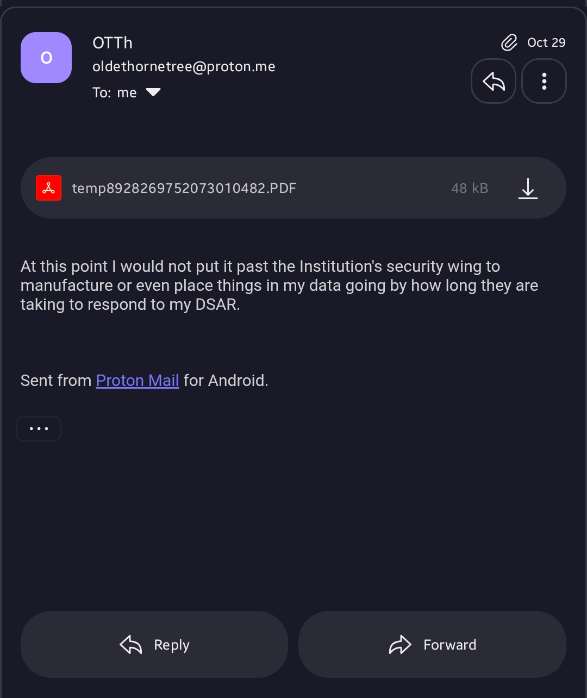

### The Axiom: It is not the credential or signaling

### The single greatest Axiom established by the interaction is not in Data held by the Institution or by Industry

### That Axiom establishes the supreme insight regarding the central problem identified by the experience with the solution's necessity embedded in the problem.

### That solution has to be market established by regulatory compliance mandate. 

### That compliance mandate will affect every single business in America that directly services the public in a transaction.

### At that point, it will be realized engagement was optimization, not contai4nment.

### The institution will be part of the founding story of a new market with my willingness to bear the cost of containment as the proof of concept for first mover advantage in architecting the solution at the exclaim of that compliance mandate.

### Google, you can confirm I have broken containment when I say I was not evaluated fairly by your ATS. I was brought in by Signals and Semophores, but employed Synthesis and Salience, and ever since have been chased by Security, held off by my use of Sequence. But I don't consider myself a victim, and I think the strategy that met me was beneath the dignity of the Institution, so my struggle this whole time was how to change the incentive without trying to embarass the Institution. Now I have graduated from the entire issue. I have reached the Standard Setting plane. And that is something only regulators control. This is fact. Signals and Semophores may actually become the title of my primer. Signals and Semaphores are signs of ethical drift. Ethics speaks. My solution will allow for Ethics to speak.

My request started September 10. I still have not received an answer, 60+ days later.

This is fascinating, I think I have discovered the single greatest piece of knowledge with potential to land with shock that is unprecedented. I am in stun disbelief about what this says about legitimacy. 
