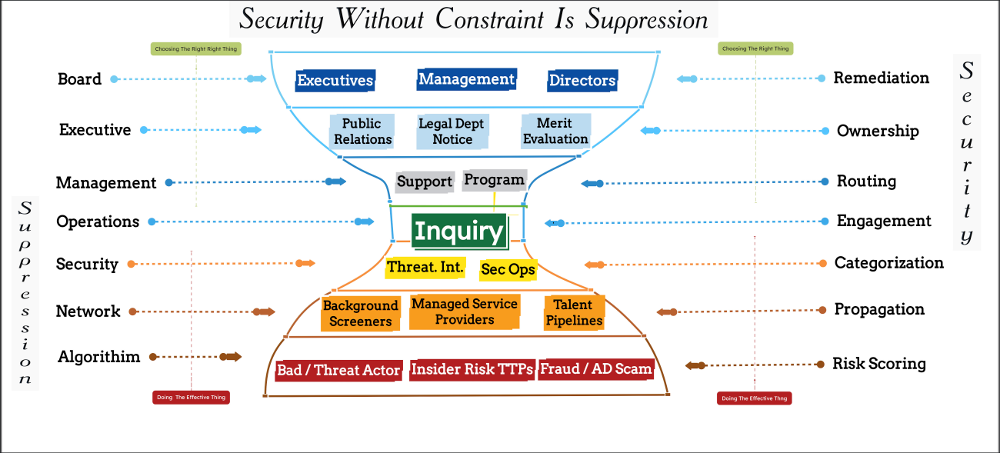
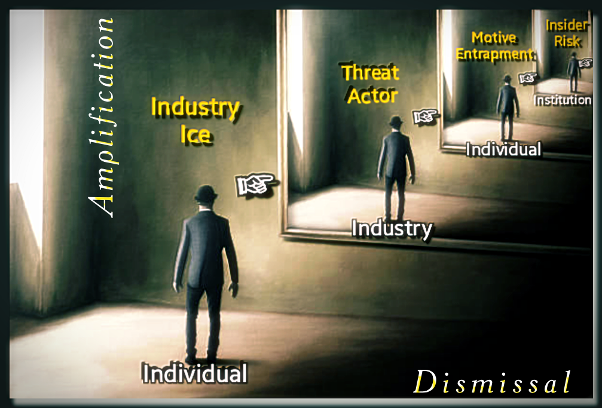

 > ##### I would like to say to the Institution, unfortunately I have bound myself so completely, we are in the same boat; there is nothing I can do. I have liabilities to mitigate as well. You see, I ruled out application, then flasified it, followed by taking a vow. Now, sometimes I change my mind on various decisions, but those decisions were never integrity constrained. It just will not do. Now, suppose that the auspicies was produced in connection to something with relevance to ownership; then, in such a case, I would naturally have to balance the reconciliation betweem my choice and my ownership, but here I am just engaged by my choice.
>
---

# Let Us Not Lose Context That A Real Life Human Being Rose In His Legitimate Defense

 

---

# COUP D'ŒIL: TECH IS MISSING THE FINAL C — CUSTOM!

Holy Mother of Hell, I found the highest Axiom at the root of so much of Tech's societal, governmental, and even  liability trials.

TECH HAS CODE, CONTEXT, AND EVEN WHAT IT REFERS TO AS 'CULTURE' BUT TECH IS BEREFT OF CUSTOM!

Big Tech is missing Custom!

Not culture, Custom!

Many countries and cultures value freedom, but how many institute democracy?

How about universal suffrage?

How about guarantee the right to bear arms as a last check against tyranny?

Many countries and cultures value freedom, but those last 3 factors are specific American CUSTOMS underpinning the value of Freedom.

What is Custom vs Culture.

Culture is App store.

Custom is your App.

Digital commerce is very new. It is not the mom and pop store down the block.

It is distributed, and so far Divorced from the normative formations at the heart of the commerce between an American citizen and corporation.

All this time I saw it relevant to bring in diplomacy, diplomatic protocol, culture, philosophy, history, ethics; none from a place of demonization or strategy, but almost symposium, I was sensing the axiom before I could identify it.

Even my use of props, elaborate symolism, the reference to "Truth-Making By Theatrical Production" were all a subconscious intuition of discovering missing Custom.

Customs are performative, symbolic, even ritualistic. Put one's hand across the heart for the flag IS an American ritual!

TECH HAS CODE, CONTEXT, AND EVEN WHAT IT REFERS TO AS 'CULTURE,' BUT TECH IS BEREFT OF CUSTOM!

THAT MISSING CUSTOM IS WHY THERE IS ESTRANGEMENT BETWEEN BIG TECH AND THE AMERICAM CONSUMER.

THOSE CUSTOMS WERE SUPPOSED TO INCUBATE THE 'RELATEDNESS' BETWEEN THE INDUSTRY AND THE PUBLIC!

IF YOU DO NOT HAVE COMMONALITY OF RELATEDNESS THAN YOU ARE ALIEN.

SO WHY WOULDN'T THERE BE ESTRANGEMENT?

AND WHY WOULDN'T THERE BE DISTRUST?

AND WHY WOULD THERE NOT BE CONFLICT?

It should not even be surprising if this discovery turns out to be why I kept pushing this engagement. I am an integrated culural systems engineer if such a system exists. 

Big Tech even has the Byzantine general's problem because there is no genuine custom uniting them. Even what goes for cooperaion is mutual defense against a threat, which may possibly have even become a threat directly as a consequence to Tech's missing Customs substrat9a.

---

# FINDING: THE ENTIRE EXPERIENCE COMES DOWN TO II IMPEDIMENTS 

 ## The Response: Affected By Sequentiality.
 > ##    It Contributed to Dismissal.
>  ##    The Solution is Continuity.

 ## The Reaction: Affected By Proportionality.
 >  ## It Contributed to Amplification.
>  ## The Solution is Calibration.

 

 ---
 >  LEDGITAL GAR, From Acrimony, To Agreement

Legible, Legitimate, Legally-inspired for Digital Reconciliation

