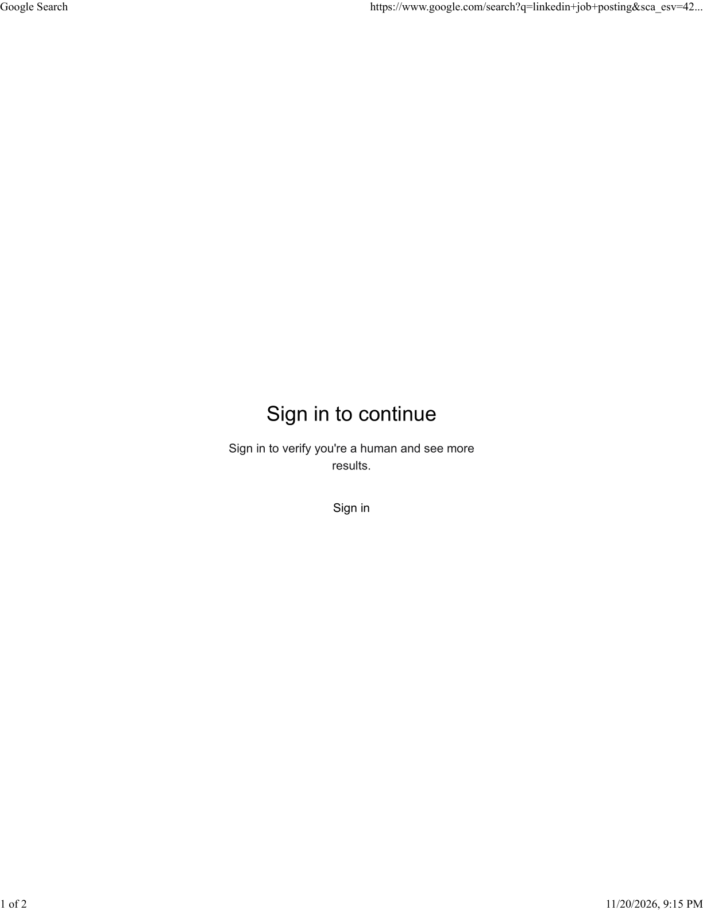

1. Canada = the controllership
2. Data = the application
3. AI = the processing
4. American recruiting = the posting
5. Exclusion = the outcome

The logic = The data is under Canadian controllership, which is subject to Canadian law, but is processed for American posting, which makes it orphaned data, bound to neither jurisdictions. It is free floating. Canadian law is jurisdiction-scoped to Canadian public job postings, and American law is concerned with data processed under American jurisdiction. So the posting for a city in the United States, is processed by an Ontario platform. The data is orphaned. Subject to no AI handling protections.


    ↑⠀⠀⠀⠀⠀⠀⠀⠀⠀⠀⠀⠀⠀⠀⠀⠀⠀⠀⠀⠀⠀⠀⠀⠀⠀⠀⠀⠀⠀
```
⠀⠀⠀⠀⠀⠀ ⣿⣿⠀⠀⠀⠀⠀⠀⠀⠀⠀⠀⠀⠀⠀⠀
⠀⠀⠀⠀⠀⡀⢸⣿⡇⢠⡀⠀⠀⠀⠀⠀⠀⠀⠀⠀⠀⠀⠀⠀⠀⠀⠀⠀⠀⠀
⠀⠀⠀⠀⣼⠇⢸⣿⡇⠀⠙⣷⣤⡀⠀⠀⠀⠀⠀⠀⠀⠀⠀⠀⠀⠀⠀⠀⠀⠀
⠀⠀⢀⣼⠋⠀⢸⣿⡇⠀⠀⡇⠈⠛⢷⣦⣄⡀⠀⠀⠀⠀⠀⠀⠀⠀⠀⠀⠀⠀
⠀⣰⡟⢻⠀ ⢸⣿⡇⠀⠀⡇⠀ ⢸⡇⠉⠛⢿⡶⠦⣤⣄⣀⣀⣀⣀⣀⣀⠀
⠀⠋⠀⢸⠀ ⢸⣿⡇ ⠀⡇⠀ ⢸⡇⠀ ⠀⢸⠀⠀  ⣿⠈⠉⠙⡟⠉⠉⠀⠀
⠀⠀⠀⢸⠀⠀⢸⣿⡇⠀⠀⡇⠀⠀⢸⡇ Dataset ⣿⠀⠀ ⠀⡇⠀⠀⠀
⠀⣤⣤⣬⣤⣤⢸⣿⡇⣤⣤⣥⣤⣬⣥⣤⣤⣬⣤⣤⣤⣭⣤⣤⣤⣥⣤⣤⣤⠀
 ⠛⠛⠛⠛⠛⢸⣿⡇⠘⠛⠛⠛⠛⠛⠛⠛⠛⠛⠛⠛⠛⠛⠛⠛⠛⠛⠛⠛⠀
⠀⠀⠀⠀⠀ ⠀⢸⣿⡇⠀⠀⠀⠀⠀⠀⠀⠀⠀⠀⠀⠀⠀⠀⠀⠀⠀⠀⠀⠀⠀
⠀⠀⠀⠀⠀ ⠀⢸⣿⡇⠀⠀⠀⠀⠀⠀⠀⠀⠀⠀⠀⠀⠀⠀⠀⠀⠀⠀⠀⠀⠀
⠀⠀⠀⠀⠀⠀ ⢸⣿⡇⠀⠀⠀⠀⠀⠀⠀⠀⠀⠀⠀⠀⠀⠀⠀⠀⠀⠀⠀⠀⠀
⠀⠀⠀⠀ ⠀⠀⠘⠛⠃⠀⠀⠀⠀⠀⠀⠀⠀⠀⠀⠀⠀⠀⠀⠀⠀⠀⠀⠀⠀⠀
⫘⫘⫘⫘⫘⫘
```
↓



