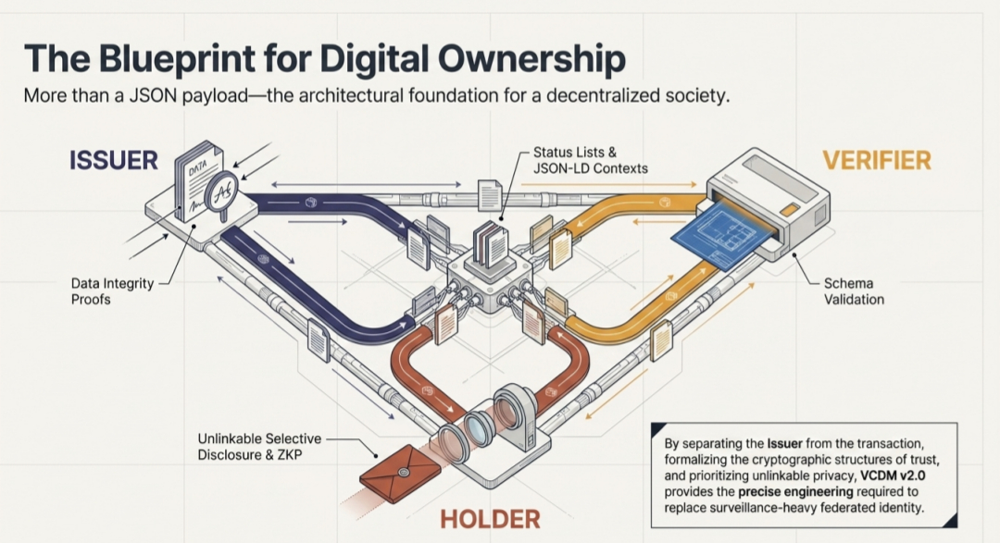

#### ***
`I Have Made The Decision To Accept The Invitation To University Research Partnership`***

---

#  

 ## 
***`The Dataset Will Be The Fieldwork For An Epistemic Security Dissertation on Algorithmic Governance Architecture, Digital Trust, Provenance, and Signal Integrity Standards for Knowledge Procurement, Credentialing, and Verification in Distributed Trust-Based Ecosystems`***

*

#### But first, due to the legal intersection of the Dataset, for the protection of subject rights as well as observer equities, as wells as the possibility that there may be publicly relevant equity the observer cannot unilaterally account, there will be rigorous legal consultations before the Dataset can be given the greenlight for academic submission.

### `The Price for the Free Market is Vigilance for the Protection of Freedom`

> ### Safety and Censorship art Twins, Which art Linked if not Exchangeable but for Separation only by Integrity!

###### * *Attribution: That image was made with Google Notebook. Its purpose is Truth-Making By Theatrical Production. The importance of Digital Signal Integrity, Provenance, Attribution, and Trust is not being exclaimed, it is being performed.*
