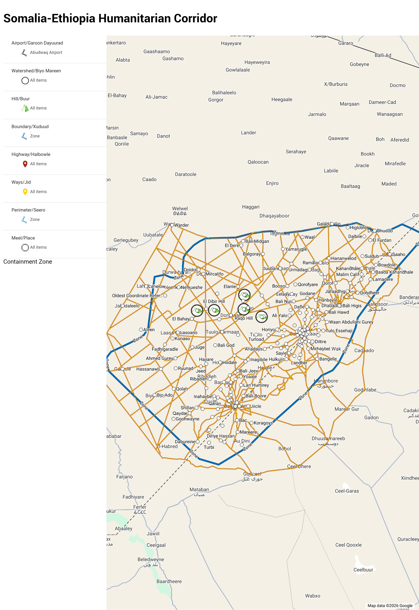

> *I will try to aim a pre-print for next Friday. It should not take longer. If completed earlier, it will be printed when completed.*

>>  ###  An Interdisciplinary Epistemic Security Case Study: Procedural Nullity in Algorithmic Hiring [As|&] Institutional Response Architecture to Structural Signal Integrity Intervention
 
---

### `The Structural Impossibility Finding`
#### A self-documenting, longitudinal, cross-platform audit of algorithmic candidate management infrastructure operating within institutional bounds and at the ecosystem level exceeding corporate boundaries.
~~~
Some insights about signal delivery language
    1. Moral or Market elicits proactive signal response
    2. Race or Identity exhibits cautious signal Handling
    3. Accountability elicits reactive signal non-cooperation
    4. Resolution returns inactive signal non-transmission 
~~~

In short: There is simply no mechanism capable of recognizing accurate system-state knowledge that diverges from the internally-correct system-state knowledge. The process optimizes for resolving that gab by delegating responsibility for resolution to external juridical-state escalation. To interrupt that optimization (e.g. ruling out legal and civil claims, and non-adversarialism) is divergent and classified anomalous, which justfies liability-containment protocols. It is a completely self-sufficient loop of Structural Impossibility.

---

***`Inspiration: Universally Inclusive* Structures`***

> Long-Term: Doctorate In Epistemic Security & Trust Architecture

> Mid-Term: Public policy-backing for Digital Dispute Resolution

> Short-Term: VCI, Digital Provenance Trust, Signal Integrity Registry

>> Information Security, Governance, Rsk, Compliance, and Assurance
>> 
***`Lifelong Goal: Daily learning & Chewing Broccoli`***

###### * *Black, White, Minority, Majority, East, West, Spiritual, Non-believing, Cis, non-Cis, Lean, Round, Abled, Disabled, Senior, Junior, Developed, Developing, Everyone, Anyone should have equal access.*

---

#  📁 Mo's Epistemic Security [EpiSec] Learning, Projects, and Portfolio 

>Each artifact emphasizes evidence-based reporting, operational discipline, and clear documentation.

---

## 0. Beginning of Security Interest

## 📚 1. Case Studies

### [SolarWinds Supply Chain Attack](https://github.com/Aarception/cybersecurity-portfolio/tree/main/solarwinds-supply-chain-attack)  
**Path:** `/solarwinds-supply-chain-attack/`

Contents:  
- [solarwinds-attack-report.md](https://github.com/Aarception/cybersecurity-portfolio/blob/main/solarwinds-supply-chain-attack/solarwinds-attack-report.md) — Full incident analysis  
- [Diagram.png](https://github.com/Aarception/cybersecurity-portfolio/blob/main/solarwinds-supply-chain-attack/Diagram.png) — MITRE ATT&CK Matrix diagram  

---

## 💻 2. Penetration Testing Workflows

### [Metasploitable2 Penetration Testing](https://github.com/Aarception/cybersecurity-portfolio/tree/main/metasploitable2-penetration-testing)  
**Path:** `/metasploitable2-penetration-testing/`

Contents:  
- [metasploitable2.md](https://github.com/Aarception/cybersecurity-portfolio/blob/main/metasploitable2-penetration-testing/metasploitable2.md) — Exploitation workflow and findings  
- [`screenshots/`](https://github.com/Aarception/cybersecurity-portfolio/tree/main/metasploitable2-penetration-testing/screenshots) — Evidence from exploitation steps  

---

## 💾 3. Technical Labs

This repository contains incident‑driven cybersecurity case studies, penetration‑testing workflows, and reproducible technical labs.

Hands‑on, reproducible exercises documenting analysis, exploitation, auditing, and system hardening.

All labs are located under:  
`/labs/`

### Current Labs

| Lab | Path | Key Files |
|-----|------|----------|
| [SYN Flood Attack](https://github.com/Aarception/cybersecurity-portfolio/tree/main/labs/SYN-flood-attack) | `/labs/SYN-flood-attack/` | [Report.md](https://github.com/Aarception/cybersecurity-portfolio/blob/main/labs/SYN-flood-attack/Report.md), [`screenshots/`](https://github.com/Aarception/cybersecurity-portfolio/tree/main/labs/SYN-flood-attack/screenshots) |
| [Hardening Against Brute Force](https://github.com/Aarception/cybersecurity-portfolio/tree/main/labs/hardening-against-brute-force) | `/labs/hardening-against-brute-force/` | [Report.md](https://github.com/Aarception/cybersecurity-portfolio/blob/main/labs/hardening-against-brute-force/Report.md), [`screenshots/`](https://github.com/Aarception/cybersecurity-portfolio/tree/main/labs/hardening-against-brute-force/screenshots), [tcpdump-traffic-log.pdf](https://github.com/Aarception/cybersecurity-portfolio/blob/main/labs/hardening-against-brute-force/tcpdump-traffic-log.pdf) |
| [IAM Governance SQL Audit](https://github.com/Aarception/cybersecurity-portfolio/tree/main/labs/iam-governance-sql-audit) | `/labs/iam-governance-sql-audit/` | [Report.md](https://github.com/Aarception/cybersecurity-portfolio/blob/main/labs/iam-governance-sql-audit/Report.md), [`screenshots/`](https://github.com/Aarception/cybersecurity-portfolio/tree/main/labs/iam-governance-sql-audit/screenshots) |
| [Least Privilege Enforcement](https://github.com/Aarception/cybersecurity-portfolio/tree/main/labs/least-privilege-enforcement) | `/labs/least-privilege-enforcement/` | [Report.md](https://github.com/Aarception/cybersecurity-portfolio/blob/main/labs/least-privilege-enforcement/Report.md), [`screenshots/`](https://github.com/Aarception/cybersecurity-portfolio/tree/main/labs/least-privilege-enforcement/screenshots) |
| [Linux Terminal Basics](https://github.com/Aarception/cybersecurity-portfolio/tree/main/labs/linux-terminal-basics) | `/labs/linux-terminal-basics/` | [Report.md](https://github.com/Aarception/cybersecurity-portfolio/blob/main/labs/linux-terminal-basics/Report.md), [`screenshots/`](https://github.com/Aarception/cybersecurity-portfolio/tree/main/labs/linux-terminal-basics/screenshots) |
| [Network Incident Analysis](https://github.com/Aarception/cybersecurity-portfolio/tree/main/labs/network-incident-analysis) | `/labs/network-incident-analysis/` | [Report.md](https://github.com/Aarception/cybersecurity-portfolio/blob/main/labs/network-incident-analysis/Report.md), [`screenshots/`](https://github.com/Aarception/cybersecurity-portfolio/tree/main/labs/network-incident-analysis/screenshots) |
| [Network Protocols (Wireshark)](https://github.com/Aarception/cybersecurity-portfolio/tree/main/labs/network-protocols-wireshark) | `/labs/network-protocols-wireshark/` | [Report.md](https://github.com/Aarception/cybersecurity-portfolio/blob/main/labs/network-protocols-wireshark/Report.md), [`screenshots/`](https://github.com/Aarception/cybersecurity-portfolio/tree/main/labs/network-protocols-wireshark/screenshots) |
| [Security Risk Assessment](https://github.com/Aarception/cybersecurity-portfolio/tree/main/labs/security-risk-assessment) | `/labs/security-risk-assessment/` | [Network hardening tools spreadsheet (CSV)](https://github.com/Aarception/cybersecurity-portfolio/blob/main/labs/security-risk-assessment/Network%20hardening%20tools%20-%20Sheet1.csv) |

---

## 🧩 4. Shared Assets

- [`/screenshots/`](https://github.com/Aarception/cybersecurity-portfolio/tree/main/screenshots) — Global screenshot directory  
- Evidence captures embedded across labs and case studies  
- Diagrams and supporting files  

---

## 🎯 5. Assorted

- [Expanding case study library](https://github.com/Aarception/cybersecurity-portfolio/tree/main/solarwinds-supply-chain-attack)  
- [Strengthening evidence‑driven reporting](https://github.com/Aarception/cybersecurity-portfolio/tree/main/labs)  
- [Documenting exploitation and hardening workflows](https://github.com/Aarception/cybersecurity-portfolio/tree/main/metasploitable2-penetration-testing)  
- [Building structured, incident‑driven artifacts](https://github.com/Aarception/cybersecurity-portfolio)  

