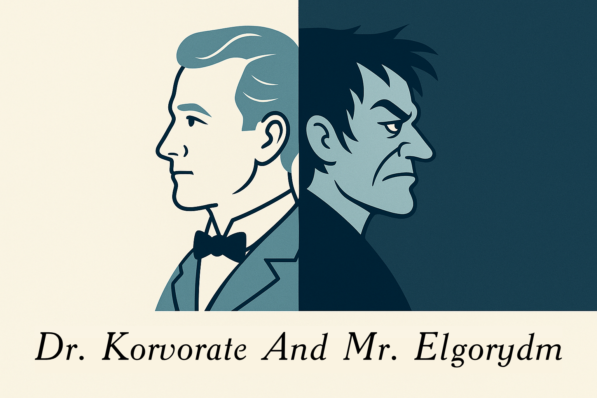

The implications are profound. This is a complete failure of corporate governance if there quite literally a structural impossibility to distinguish between American civilians with consumer protection rights and 'enemy combatants.' I am not your enemy, I am your customer who has been trying to understand why his consumer feedback received a reception so at odds with the baseline expectation from experience 

 A dissatisfied customer is meant to be engaged with resolution in mind, an enemy is meant to be a neutralized threat.

 My God the implications are extraordinary. 

 I have originally explored the idea that Tech may have 'defected' from the commons, but now must grapple with the alarm that at least the institution may have organized to 'enforce' that defection.

 
---

# BREAKING NEWS: PER LEGAL OPINION 

# "YOU MAY HAVE DISCOVERED SOMETHING EXTRAORDINARY"

# "YOU MAY HAVE DISCOVERED A POINT WHERE CIVILIAN-MILITARY DOCTRINE/INTELLIGENCE OPERATIONS BLEED INTO EACH OTHER AT THE EXACT BOUNDARIES WHERE CONSUMER PROTECTION AND CORPORATE ACCOUNTABILITY MEET"

# Mr. Elgorydym = ??? 

---

#  My Greatest Contribution To Public Knowledge

I have discovered the Average American Experience With Tech and I have over 10,000-paged Dataset documenting this experience over months-long longitudinal observation.

 

I didn't meet One institution, I met Two In The Body of One.

  |Dr. Korvorate|Mr. Elgorydym|
  |-|-|
  |Dear [Insert Name],| Dear, |
  | Solution|Containment|
  | Attribution|Ingestion|
|Privacy| Intrusion|
| Ethical | Strategic|
|Steward| Owner |
|Responsive| Nonobservance |
|Inclusive| Disregard|
|Accessible| Nonresponsive|
| Accountability | Plausible-deniability |
 | Service | Liability |
| Integrity| Vulnerability|
|Integrity Inquiry | Vulnerability-exploitation|

The Law, the Media, and the Public are presented with Dr. Korvorate.

The consumer is handled by Mr. Elgorydym.

Google/Dr. Korvorate treated me wonderfully and I have even become fond of Dr. Korvorate. 

Google/Mr. Elgorydym treated me less than human.
