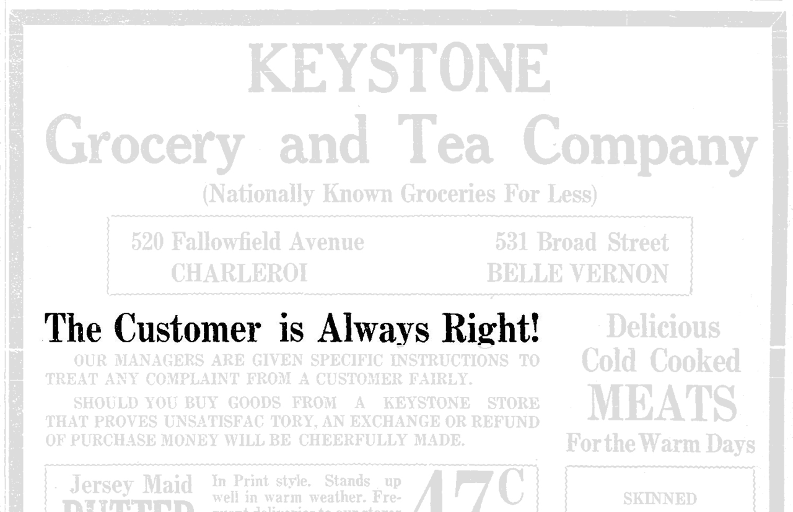

I found that in the America of today, there existed the possibility that this defining tradition of American commerce may have been downgraded:

Since the day I found out, I committed to repair.

The experience was documented along the way.
