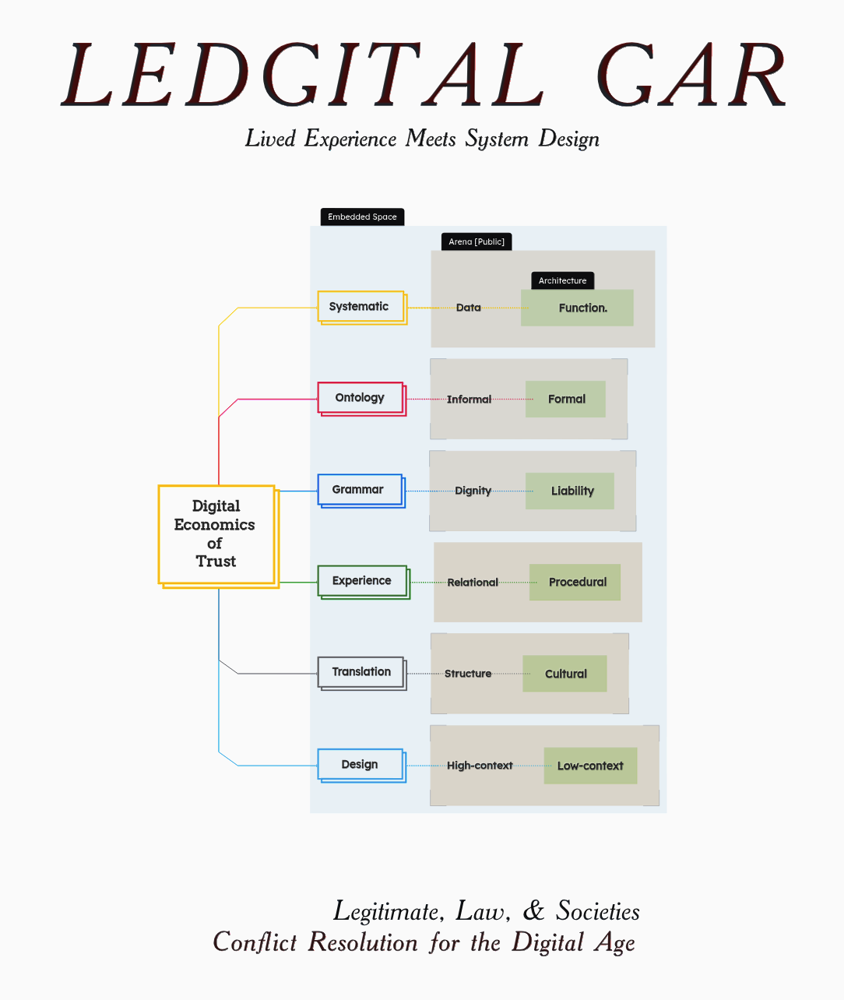

# I Think I Have Come To Understand The Cause of Big Tech's Peculiar Relationship With American Consumers

I don't know if big Tech has inventoried its place in American commerce and noticed the unique singularity occupied within American industries regarding American business relationship with American consumers.

Tech does not have a happy relationship with American consumers. Tech has a form of strategic convenience outlook which is incredibly consequential at the lowest engagement level, e.g. business to individual.

It is not warm. At all.

In fact, it is actually the inverse.

It would be impossible to function such a way and still be profitable, were it not for strategic toleration and provision of digital service rather than physical-engaged interaction.

This underlies so much of why there is almost a state of 'Failed State' or 'Banana Republic' in the contract between Big Tech and the Consumer were it not for publically-funded structures who are objects for absorbing consumer reaction and therefore keep the Failed State from passing over into instability.

I think I have come to understand the underlying cause of this: the tension between Right and Effective.

The state emanates from the tension a the nexus of CHOOSING THE RIGHT THING VS. DOING THE MOST EFFECTIVE THING.

What is the difference?

You tell me.

---

# LEDGITAL GAR*
> # From Acrimony, To Agreement

Legible, Legitimate, Legally-inspired for Digital Reconciliation

##### * *Gar is probably the most consequential word in Xeer customary law systems and essentially means "Salvation, Redeem, To Restore." For example the Somali word for judge is Garsoor, The one who brings clarity of Gar, mediation is Garnaqsi, To dialogue about Gar, relief is Gargaar, To provision Gar,  titular heads are referred Garaad, Seeker of Gar, helplessness is Garmaroorsi, to abduct Gar. Digital Gar is Digital Resolution, Reconciliation, Redemption, Restoration.*

###### *FYI: AI tooling was not used in the making of this diagram or really what it represents (this just teases a project that is exrpressly privately-protected) and really AI tooling has not been used 100% of the actual diagrams I have made. I don't apologize for AI use. It is like apologizing for using Search engine. Information development tools are meant to be used for information access. However, I understand the double entendre from security-applied cynicism, so let me just say, I have welcomed it in the past because being underestimated was a strategic value, but going forward I am going to have to start categorizing when such systems are used as opposed to the inverse, if my intellectual production is going to be divested from its origination. :)*

# Tech CEOs should emulate Bill Gates

Responsible, effective, influential, with impact that never diminishes because his influence is a generative machine that is never subordinated to the former. 

I have never met him, yet the regard I have for him is such he can single-handedly influence this very engagement in ways the concerned cannot. 

He generated that influence long-ago, when he invested in my schooling. 

That wasn't 'philanthropy;' that was investment. 

There is investment measured by stock market prices and there is investment generating influence. 

The British Crown survived, The French crown dissolved. Why? The Magna Carta, the Parliament. 

The Chinese imperial seat dissolved, the Japanese imperial seat did not. Why? The Humanity Declaration, the National Diet.

The Iranian royalty dissolved, the Saudi royalty, based in an even more religiously conservative society, did not. Why? Consultation, the Majlis Consensus.

Influence is generative, Impact is diminishing.

# Watch Congress, the Era of 'Imperial Tech CEOs" is Officially Over

I do not have a position on this on the NVIDIA issue.

What I have is an excellent nose for seeing where trends are headed.

Last month, we saw the referencing of "Imperial CEOs" re:Tech CEOs by the Wall Street Journal.

That will prove to be the climax.

The Pendulum is going to swing and it will be swung with force starting today. 

Watch Congress, watch Career regulators, watch governance industry.

Before Spring, you will see the highest Tech CEOs, hauled before Congress testifying in groups.

Results: Change management standards for Board, Ethical insurance premiums for executive, shareholder powers increases.

This might as well be Japan's Meiji years headed into de-feudalization.

Broad, sweeping de-feudalization is coming.

He who knows history, knows the future.

---

# FINDING: THE ENTIRE EXPERIENCE COMES DOWN TO II IMPEDIMENTS 

 ## The Response: Affected By Sequentiality.
 > ##    It Contributed to Dismissal.
>  ##    The Solution is Continuity.

 ## The Reaction: Affected By Proportionality.
 >  ## It Contributed to Amplification.
>  ## The Solution is Calibration.

 

 ---
 
### Costly Signal As A Token of Trust

Since September 16, I have retraced every single Institution-produced, affiliated, or linked research that was published going back to the day in which formal feedback was initiated, having graphed against my interaction with the institution controlled for daily development.

This was done in preparation for legal engagement.

It is shared now as a token of trust in support of resolution having ruled out application with the institution while still pursuing resolution

---

I will start with permanently foreclosing a confounding impediment through a vow:

`I will never apply for a role with the institution.`

