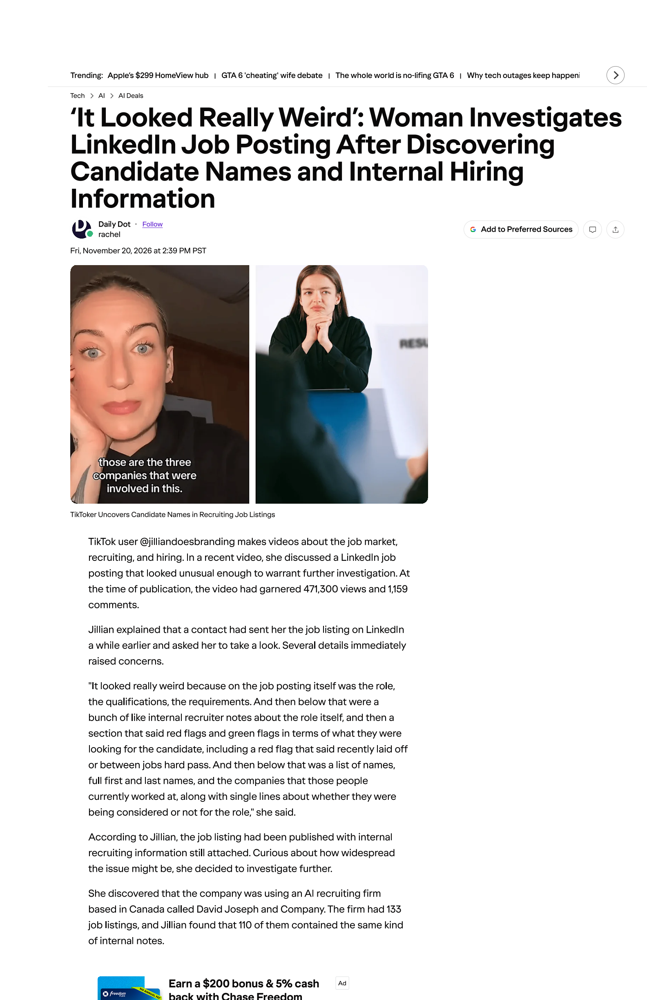

# Aarception Graphed Perception Today

What: Test the hypothesis of Industry-activation 

Who: The company that garners my warmest regard

Where: Access of endpoints —.com; —.com/security

Control: Open subdomains, one being learn.—.com, incognito, multiple vpns

How: General browsing

Documentation: Video Redcording

Outcome-

- Perception is not proactive security, it is reactive
- It remediates by giving access
- But not before confirming subjection to Industry Ice
   - Prevented from accessing public endpoints which is simultaneously confirnmed open

I sometimes wonder if there is appreciation for where this is headed.


---


1. Canada = the controllership
2. Data = the application
3. AI = the processing
4. American recruiting = the posting
5. Exclusion = the outcome

The implied logic = The data is under Canadian controllership, which is subject to Canadian law, but is processed for American posting, which makes it orphaned data, bound to neither jurisdictions. It is free floating. Canadian law is jurisdiction-scoped to Canadian public job postings, and American law is concerned with data processed under American jurisdiction. So the posting for a city in the United States, is processed by an Ontario platform. The data is orphaned,
/The reality: The 0t4y⁶⁴data is processed under Canadian law, but for an American posting, under the controllership of an unnamed client, without a single party being answerable for for the whole process. The AI processing occurs in Canada, using an American client. The gap is the is the diffused accountability. The legal protections duty concerns the posting, the accountability is bifurcated to the different handlers, and the data subject  rights is held by the applicant, but diffusion prevents those three frameworks from being united.

An applicant who attempts to begin that unification, starting with enforcing their data subject rights is met with:

  1. We have not processed such information, might be different platform
  2. We can confirm processing, but we have no legal obligation to you

Yet, the application has been indexed, evaluated, and scored by AI. The applicant has no awareness, input, or recourse to do anything about it. Others can access it, they can utilize it, but the applicant is disenfranchised from their own data, opportunity, or rights.

The application = AI indexed, evaluated, scored
The applicant = discarded, excluded by outcome
The data = name exchanged for persistent id

The chain: Routed from jurisdiction, data processed by AI, legally divested through partial anonymization, data repacked under sanitized persistent identifier, no longer subject to a subject under a jurisdiction or covered by data privacy, diffusion.

Why?


 ↑⠀⠀⠀⠀⠀⠀⠀⠀⠀⠀⠀⠀⠀⠀⠀⠀⠀⠀⠀⠀⠀⠀⠀⠀⠀⠀⠀⠀⠀
```
⠀⠀⠀⠀⠀⠀ ⣿⣿⠀⠀⠀⠀⠀⠀⠀⠀⠀⠀⠀⠀⠀⠀
⠀⠀⠀⠀⠀⡀⢸⣿⡇⢠⡀⠀⠀⠀⠀⠀⠀⠀⠀⠀⠀⠀⠀⠀⠀⠀⠀⠀⠀⠀
⠀⠀⠀⠀⣼⠇⢸⣿⡇⠀⠙⣷⣤⡀⠀⠀⠀⠀⠀⠀⠀⠀⠀⠀⠀⠀⠀⠀⠀⠀
⠀⠀⢀⣼⠋⠀⢸⣿⡇⠀⠀⡇⠈⠛⢷⣦⣄⡀⠀⠀⠀⠀⠀⠀⠀⠀⠀⠀⠀⠀
⠀⣰⡟⢻⠀ ⢸⣿⡇⠀⠀⡇⠀ ⢸⡇⠉⠛⢿⡶⠦⣤⣄⣀⣀⣀⣀⣀⣀⠀
⠀⠋⠀⢸⠀ ⢸⣿⡇ ⠀⡇⠀ ⢸⡇⠀ ⠀⢸⠀⠀  ⣿⠈⠉⠙⡟⠉⠉⠀⠀
⠀⠀⠀⢸⠀⠀⢸⣿⡇⠀⠀⡇⠀⠀⢸⡇ Dataset ⣿⠀⠀ ⠀⡇⠀⠀⠀
⠀⣤⣤⣬⣤⣤⢸⣿⡇⣤⣤⣥⣤⣬⣥⣤⣤⣬⣤⣤⣤⣭⣤⣤⣤⣥⣤⣤⣤⠀
 ⠛⠛⠛⠛⠛⢸⣿⡇⠘⠛⠛⠛⠛⠛⠛⠛⠛⠛⠛⠛⠛⠛⠛⠛⠛⠛⠛⠛⠀
⠀⠀⠀⠀⠀ ⠀⢸⣿⡇⠀⠀⠀⠀⠀⠀⠀⠀⠀⠀⠀⠀⠀⠀⠀⠀⠀⠀⠀⠀⠀
⠀⠀⠀⠀⠀ ⠀⢸⣿⡇⠀⠀⠀⠀⠀⠀⠀⠀⠀⠀⠀⠀⠀⠀⠀⠀⠀⠀⠀⠀⠀
⠀⠀⠀⠀⠀⠀ ⢸⣿⡇⠀⠀⠀⠀⠀⠀⠀⠀⠀⠀⠀⠀⠀⠀⠀⠀⠀⠀⠀⠀⠀
⠀⠀⠀⠀ ⠀⠀⠘⠛⠃⠀⠀⠀⠀⠀⠀⠀⠀⠀⠀⠀⠀⠀⠀⠀⠀⠀⠀⠀⠀⠀
⫘⫘⫘⫘⫘⫘
```
↓




