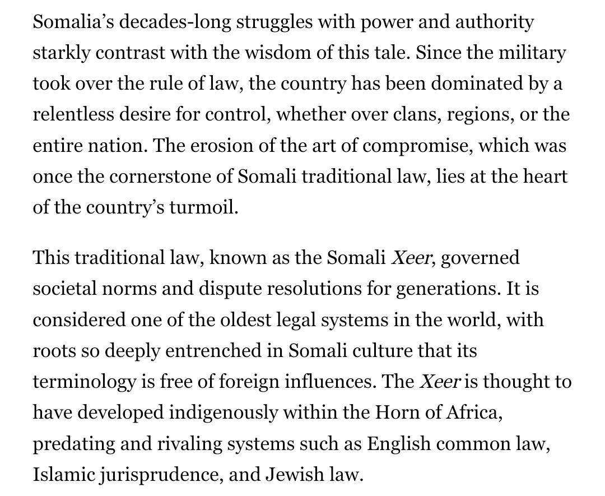
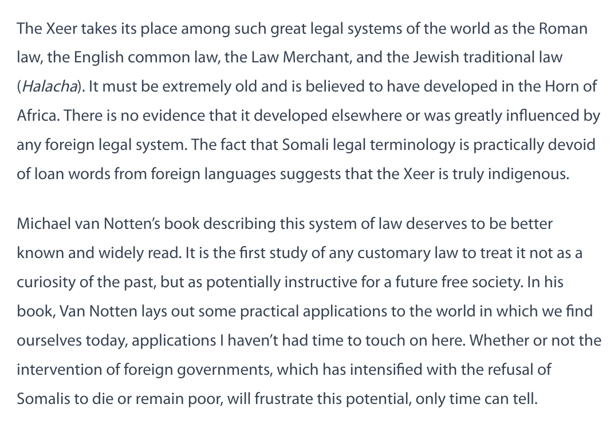
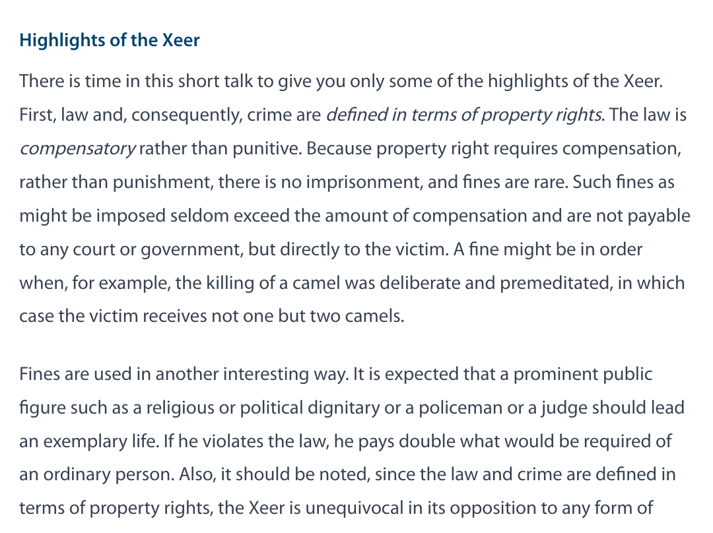
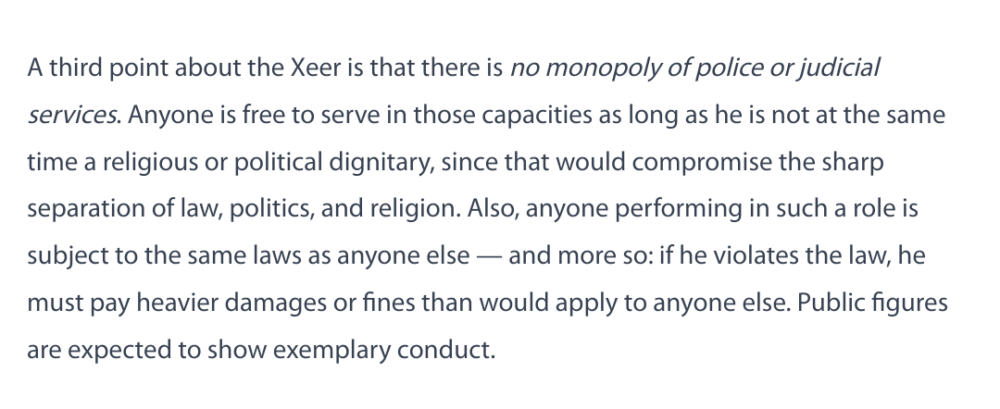

## Next: What Happens If A Mag group defects from the Pact?

A fascinating case of learning from a human culture especially adapted for decentralization.

How is defection handled?

That is coming up next, but first recall the backdrop below.

---

### Design, Defection, and the Digital Commons: A Story About What Humans From Antiquity Understood About Incentivizing The Political Economy of Responsibility

In the recent past, while visiting Somalia, I noticed something very peculiar.

Somalia has a very weak government propped up by the international community, but that government was not actually visible at any level of society.

Furthermore there was no actual law enforcement capacity or state systems of justice at all. There were named buildings and institutions which came into sharp focus amidst high-level power squabbles, but at any practical level of social life it, those entities were simply non-existent.

There were no police stations, no courts, no visible instruments of justice.

And yet, even in the farthest provinces from the Capital, in places like the region of my great-uncle, a tribal chief, there was no lawlessness, no petty crimes, no orphans on the streets, business freely operated from sunrise to midnight without harassment or fear, and they were accountable and responsive to their customers. They had even defeated Al Shabaab, a terrorist organization, at war with the protected government in Mogadishu, relying on their traditional Sufi mysticism form of the religion as an identity against extremism.

*International Policy Digest*

So after noticing how unmolested, free, and secure I had been after being taken on a two hour car ride out to a special, hilly grazing favorite with beautiful meadows and streams, for fresh camel milk, I became curious about the invisible system underpining this order without any visible existence of state rule.

So I asked my great-uncle, what is this system and what happens if something like a murder takes place?

My grand-uncle said this system is called Xeer (pronounced Hare) our ancient customary law, among the world's developed natural law systems equivalent with English common law and the Urf of the Arabian peninsula. It came before the State and exists after the State. 

Somalia is an arid country, historically the people had to rely on pastoralism, which required seasonal migration for resource security. That migration made centralized rule difficult, so there were no sovereign kings or systems of rooted order. As a result, society developed into 'Mag' group, and each Mag group is a Dia-paying group. Dia is blood price, the cost of murder being 100 camels, or about $100,000. 

*Austrian M.I Institute*

Every member of the Mag is insured and pays the premium meaning the individual is a property of the Mag and a beneficiary of the Mag. A murder of a member of the Mag is a loss of property to every member of the Mag and criminality by a member of the Mag is culpability of every member of the Mag. So the Mag both enforces deterrance to external criminality as well as self-polices internal criminality. [This is why I have said before the vexing question of agentic AI alignment may possibly be resolved by the stateless cultural code of Somalia]

The property rights definition of Xeer is central to the resiliency in the face of lawlessness. When courts do not exist, police stations are nowhere to be seen, and jails have no centralized purpose, punishment is irrelevant and inconsequential. The loss of a man is a loss of a bread-winner to the household, a loss of a premium to the Mag, and a loss of production to both. In this manner, Xeer is relevant because it restores the practical value of what is lost. So the 100 Dia for murder is the insurance of property and the judgment is indemnity of the offender.

*Austrian M.I Institute*

Somalia has the largest number of camels in the world. In fact, by some estimates, the number is quivalent to the sum of camels in north Africa and the Arabian Gulf combined. It provides an important economic value and is the largest export, Somalia's livestock feeding the annual Hajj migration to Saudi Arabia. The market price of the average camel is $850-$950, dependifng the season, with a gestating She-camel above $1000. A stud is upwards of $3,000-$5,000, and because only one stud is allowed to mate per cycle, often a well regarded stud will be rented, providing more value. The 100 camel Dia must always include either one stud or three she-camels, whichever is the lesser price.

In this backdrop, the Mag group-membership has to be a size that disincentvizes wanton murder, to prevent impunity and defection from the cost of failing to self-police. The mag needs to stabilize at a size where the payment for murder is not so high that it has no practical effect, but not so low that the cost is meaningless and without purpose. The mag contracts and diffuses into smaller units after every number of generations. 

*Austrian M.I Institute*

Secondly, a maiden is added to the dia payed to the victim's Mag. In Somali culture, women do not receive a dowry from family to take into her new household. The grom's family supplies the Dowry to her birth family. Maidens in this manner serve an important economic role in the Mag and often, Maidens represent important links tying alliances, relations, and grazing route opportunities in hard times. They are not just extended, without gain, and without future value. The addition of the maiden on top of the Dia for the cost of murder represents a non-fungible, consequential price reinforcing self-policing.

Thirdly, Samafal is triggered in the event the victim left dependents or extenuating reponsibilities with societal effect. Samafal, whose literal translation is Sama, or Good, and fal, or to do, is the Somali word for humanitarianism. If the victim left orphans, elder parents, or other charges  or wards, by Xeer customary law, the offending Mag group must take up that lost responsibility or upkeep of that responsibility for a set number of years, often pegged to the first dependent to reach of age.

The reason why I did not see lawlessness in the world's foremost failed state is because Somalia's Algorithmic Accountability is a bulwark against both the Chaotic Desert and the Ordered Chaos of Mogadishu's institutions.
 
