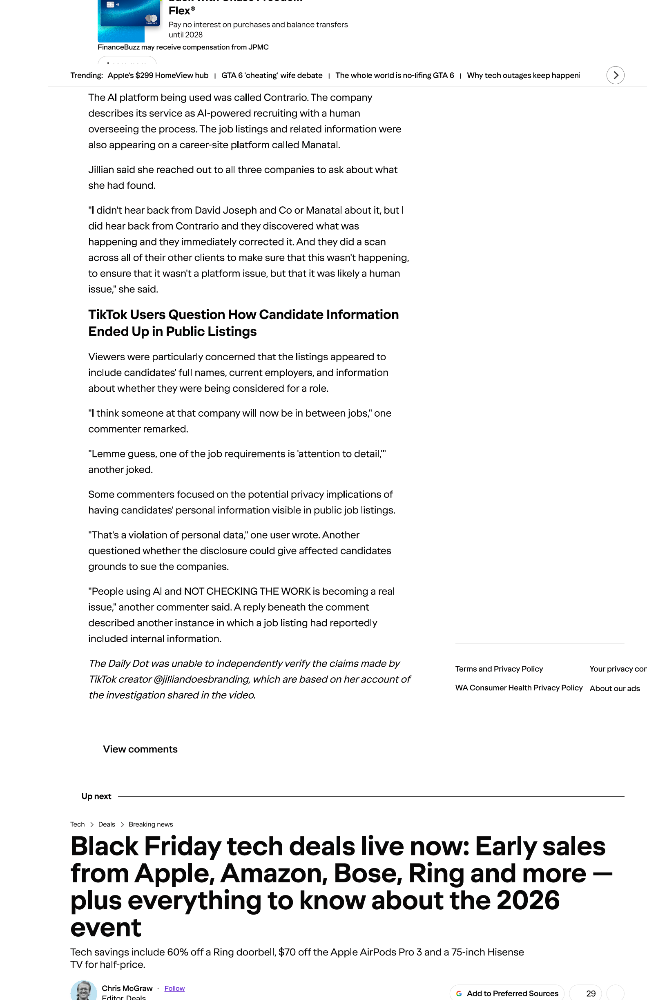

1. Canada = the controllership
2. Data = the application
3. AI = the processing
4. American recruiting = the posting
5. Exclusion = the outcome

The implied logic = The data is under Canadian controllership, which is subject to Canadian law, but is processed for American posting, which makes it orphaned data, bound to neither jurisdictions. It is free floating. Canadian law is jurisdiction-scoped to Canadian public job postings, and American law is concerned with data processed under American jurisdiction. So the posting for a city in the United States, is processed by an Ontario platform. The data is orphaned,

The reality: The data is processed under Canadian law, but for an American posting, under the controllership of an unnamed client, bound to neither jurisdictions. The AI processing occurs in Canada, using an American client. The gap is the is the diffused accountability. The legal protections duty concerns the posting, the accountability is bifurcated to the different handlers, and the data subject  rights is held by the applicant, but diffusion prevents those three frameworks from being united.

An applicant who attempts to begin that unification, starting with enforcing their data subject rights is met with:

  1. We have not processed such information, might be different platform
  2. We can confirm processing, but we have no legal obligation to you

The application is ingested into training material. The applicant has no awareness, input, or recourse to do anything about it. Others can access it, they can utilize it, but the applicant is disenfranchised from their own data, opportunity, or rights.

The application = AI indexed
The applicant = discarded


 ↑⠀⠀⠀⠀⠀⠀⠀⠀⠀⠀⠀⠀⠀⠀⠀⠀⠀⠀⠀⠀⠀⠀⠀⠀⠀⠀⠀⠀⠀
```
⠀⠀⠀⠀⠀⠀ ⣿⣿⠀⠀⠀⠀⠀⠀⠀⠀⠀⠀⠀⠀⠀⠀
⠀⠀⠀⠀⠀⡀⢸⣿⡇⢠⡀⠀⠀⠀⠀⠀⠀⠀⠀⠀⠀⠀⠀⠀⠀⠀⠀⠀⠀⠀
⠀⠀⠀⠀⣼⠇⢸⣿⡇⠀⠙⣷⣤⡀⠀⠀⠀⠀⠀⠀⠀⠀⠀⠀⠀⠀⠀⠀⠀⠀
⠀⠀⢀⣼⠋⠀⢸⣿⡇⠀⠀⡇⠈⠛⢷⣦⣄⡀⠀⠀⠀⠀⠀⠀⠀⠀⠀⠀⠀⠀
⠀⣰⡟⢻⠀ ⢸⣿⡇⠀⠀⡇⠀ ⢸⡇⠉⠛⢿⡶⠦⣤⣄⣀⣀⣀⣀⣀⣀⠀
⠀⠋⠀⢸⠀ ⢸⣿⡇ ⠀⡇⠀ ⢸⡇⠀ ⠀⢸⠀⠀  ⣿⠈⠉⠙⡟⠉⠉⠀⠀
⠀⠀⠀⢸⠀⠀⢸⣿⡇⠀⠀⡇⠀⠀⢸⡇ Dataset ⣿⠀⠀ ⠀⡇⠀⠀⠀
⠀⣤⣤⣬⣤⣤⢸⣿⡇⣤⣤⣥⣤⣬⣥⣤⣤⣬⣤⣤⣤⣭⣤⣤⣤⣥⣤⣤⣤⠀
 ⠛⠛⠛⠛⠛⢸⣿⡇⠘⠛⠛⠛⠛⠛⠛⠛⠛⠛⠛⠛⠛⠛⠛⠛⠛⠛⠛⠛⠀
⠀⠀⠀⠀⠀ ⠀⢸⣿⡇⠀⠀⠀⠀⠀⠀⠀⠀⠀⠀⠀⠀⠀⠀⠀⠀⠀⠀⠀⠀⠀
⠀⠀⠀⠀⠀ ⠀⢸⣿⡇⠀⠀⠀⠀⠀⠀⠀⠀⠀⠀⠀⠀⠀⠀⠀⠀⠀⠀⠀⠀⠀
⠀⠀⠀⠀⠀⠀ ⢸⣿⡇⠀⠀⠀⠀⠀⠀⠀⠀⠀⠀⠀⠀⠀⠀⠀⠀⠀⠀⠀⠀⠀
⠀⠀⠀⠀ ⠀⠀⠘⠛⠃⠀⠀⠀⠀⠀⠀⠀⠀⠀⠀⠀⠀⠀⠀⠀⠀⠀⠀⠀⠀⠀
⫘⫘⫘⫘⫘⫘
```
↓





